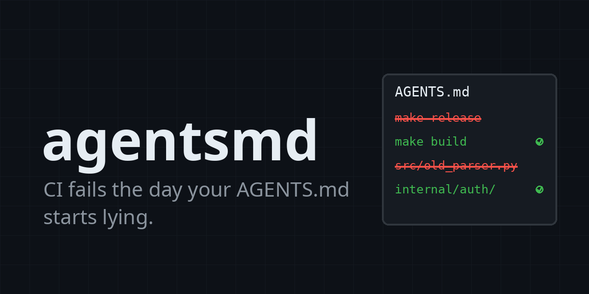

**Your coding agent just ran `make release` - a target deleted three months ago. Your AGENTS.md told it to.**

AGENTS.md files rot. Code moves, scripts get renamed, versions bump, and the instruction file keeps pointing agents at things that no longer exist. The agent doesn't complain; it hallucinates around the lie and burns your tokens doing it.

agentsmd is a CI gate that fails the day the drift starts. It statically verifies that every path, script and version your AGENTS.md references still exists in the repo. No LLM calls, no code execution - just diff-fast static checks that turn silent drift into a red build.

```text
$ agentsmd check
AGENTS.md:5 [drift/missing-script] referenced make target "release" is not defined in the Makefile
  fix: update the instructions to a target that exists, or add the target
AGENTS.md:7 [drift/missing-path] referenced path "internal/parser/legacy.go" does not exist
  fix: update the reference to the current location, or delete it
agentsmd: AGENTS.md - 2 errors, 0 warnings
```

## What it checks

| Rule | Level | Catches |
| --- | --- | --- |
| `drift/missing-path` | error | Backticked paths and relative markdown links that no longer exist |
| `drift/missing-script` | error | `make` targets and `npm`/`pnpm`/`yarn`/`bun` scripts that were renamed or deleted |
| `drift/version-mismatch` | warning | "Requires Go 1.22" while go.mod says 1.26; "Node 18" while engines says >=20 |
| `bloat/token-budget` | warning | Instruction file over the token budget (default 2500; every token ships in every prompt) |
| `bloat/readme-duplication` | warning | Paragraphs copy-pasted from README.md that agents would read anyway |

Every finding comes with the exact line and a concrete fix. Errors fail the build; warnings don't.

## Use it

**GitHub Actions**

```yaml
- uses: ofershap/agentsmd@v0.1.0
```

That's the whole workflow step. Findings appear in the job log; pass `-format sarif` for code scanning annotations.

**Any CI or local shell**

```sh
go install github.com/ofershap/agentsmd@v0.1.0
agentsmd check
```

**Options**

| Flag | Default | Meaning |
| --- | --- | --- |
| `-root` | `.` | Repository root to check against |
| `-file` | `AGENTS.md` | Instruction file (point it at CLAUDE.md or any other) |
| `-format` | `text` | `text` or `sarif` |
| `-budget` | `2500` | Token budget, estimated as bytes/4; `0` disables |

## What it doesn't do

- **It never executes repository content.** Verification is pure static checking: paths are stat'ed, scripts are looked up in package.json/Makefile, versions are compared as strings.
- **It doesn't write or rewrite your AGENTS.md.** Generation is a solved problem - every coding agent already does it. Drift detection is the missing half.
- **It doesn't score or grade.** A reference either resolves or it doesn't. Pass/fail, not vibes.

<details>
<summary><strong>FAQ</strong></summary>

**Why does AGENTS.md drift matter?**
Coding agents treat AGENTS.md as ground truth. When it references a deleted script or a moved directory, the agent still tries to follow it - wasting tool calls, producing confused edits, and eroding trust in the file. Two recent studies of real repositories found instruction files routinely go stale as code evolves.

**Can't my agent just fix the file itself?**
It can, but only after someone notices. agentsmd makes the breakage a build failure at the exact commit that causes it, instead of a quiet degradation nobody attributes.

**Does it work with CLAUDE.md, .cursorrules, or other instruction files?**
Yes - pass `-file CLAUDE.md` (or any path). The checks are format-agnostic: they verify references, not the filename.

**What about false positives?**
Only unambiguous references are checked: paths with a directory separator or a known file extension, relative markdown links, and script invocations in backticks. Plain prose is never flagged. Version mismatches and bloat are warnings, not errors.

**How is the token count estimated?**
As bytes divided by 4, the standard rough estimate for English text. It's stable enough to gate on trend, not exact enough to argue about.

</details>

## License

MIT
